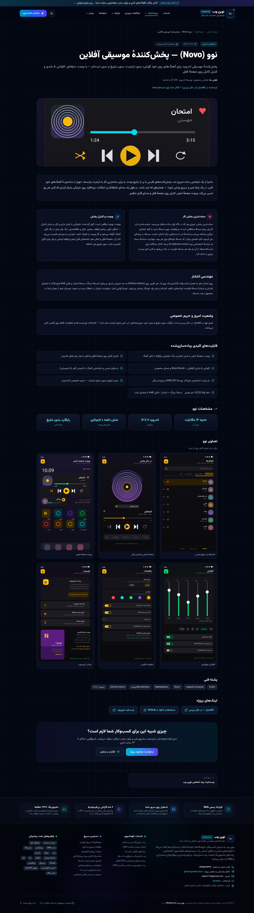
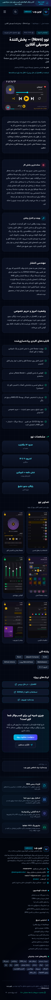

# نمونه‌کار نوو — گزارش تغییر و بررسی

## نتیجه

- مسیر جدید: `/projects/novo-music-player`، در گرید فعلی `/projects` و فیلتر «اپلیکیشن اندروید».
- متن آمادهٔ کارفرما در `src/data/novo-music-player.json` بدون بازنویسی نگه‌داری شده است. آرایهٔ موجود `PROJECTS` همان متن را به قالب فعلی می‌دهد؛ پنج پاراگراف روایت، هفت قابلیت و چهار مشخصه دقیقاً از JSON می‌آیند.
- وضعیت کافه‌بازار در کارت، صفحه و لینک فروشگاه «در حال بررسی» است. هیچ تعداد نصب، امتیاز، رتبه یا مشتری تازه‌ای اضافه نشده است.
- صفحه شامل نقش تیم، روایت شروع پروژه، چالش نصب و راه‌حل آن، ویجت، مهندسی انتشار، حریم خصوصی، مشخصات، گالری، پشتهٔ فنی و سه لینک داده‌شده است.
- عنوان، توضیحات، canonical، Open Graph و Twitter برای همین نمونه‌کار تنظیم شده‌اند. `generateStaticParams` و sitemap موجود، مسیر جدید را خودکار می‌گیرند؛ فایل sitemap تغییر نکرده است.

## فرض‌ها و محدوده

۱. فهرست نمونه‌کارها همان `/projects` است؛ `/case-studies` صفحهٔ دیگری است و تغییر نکرده است. مسیر `/works` یا کامپوننت، کتابخانه و طراحی تازه‌ای ساخته نشده است.
۲. سایت فارسی و راست‌به‌چپ است؛ نسخهٔ انگلیسی تازه‌ای اضافه نشده است. دادهٔ انگلیسی عنوان، همان‌طور که داده شده بود، در JSON باقی مانده است.
۳. نوو به انتهای آرایه اضافه شده تا پروژهٔ شاخص، سه لینک شاخص منو و شش کارت فعلی صفحهٔ اصلی جابه‌جا نشوند.
۴. در قالب مشترک فقط فیلدهای اختیاری روایت، گالری، لینک‌ها، برچسب‌ها و تصویر به کار رفته‌اند. پروژه‌های قبلی این فیلدها را ندارند و همچنان با همان قالب نمایش داده می‌شوند.
۵. دو عدد ثابت «۹ پروژه» در منو و فوتر به شمارش واقعی آرایه وصل شده‌اند. معرفی فهرست هم فقط به اندازهٔ لازم اصلاح شده تا دربارهٔ یک اپ آفلاین، ادعای استقرار روی سرور یا داشتن کاربر واقعی نکند.
۶. دامنهٔ canonical و sitemap از `NEXT_PUBLIC_SITE_URL` فعلی سایت پیروی می‌کند (پیش‌فرض مخزن: `https://webnovo.vercel.app`). لینک برند همان `webnovo.ir` با پارامترهای داده‌شده است.
۷. این جلسه به `arena/01a0f743-bot-company` متصل است؛ PR از همین شاخه به `main` ساخته می‌شود، نه از شاخهٔ تازه.

## منبع و بهینه‌سازی تصاویر

تصاویر از مخزن اصلی `jackiuns066-lgtm/appmusic`، شاخهٔ `arena/01a0f112-appmusic`، در commit زیر با clone کم‌عمق و sparse checkout دریافت شدند:

`708da25be47546830484570a9276e767e1575bfa`

مسیر منبع: `store/screenshots/`؛ مسیر سایت: `public/images/works/novo/`.
هیچ تصویری تولید یا جایگزین نشده است. شش تصویر لازمِ گالری و تصویر شاخص همگی موجود بودند. آیکون و کارت QR اختیاری در این صفحه استفاده نشده‌اند؛ دانلود فقط به صفحهٔ Releases داده‌شده لینک دارد، نه به فایل نسخه‌دار APK/AAB.

با Sharp موجود در وابستگی‌های Next.js، هر PNG به WebP **بدون افت کیفیت** تبدیل شد (`lossless: true`, `effort: 6`). ابعاد همهٔ تصاویر **۱۰۸۰ × ۱۹۲۰** حفظ شد؛ خروجی RGBA هر فایل با منبع مقایسه شد و تمام پیکسل‌ها برابر بودند. متادیتای غیرضروری تصویر نگه‌داری نشده است.

| فایل سایت | اندازهٔ PNG منبع (بایت) | اندازهٔ WebP (بایت) |
| --- | ---: | ---: |
| `01-songs-tabs.webp` | 103335 | 38262 |
| `02-now-playing-swipe.webp` | 83441 | 31722 |
| `03-home-widget.webp` | 86890 | 34024 |
| `04-equalizer.webp` | 70848 | 25182 |
| `05-settings-fa.webp` | 98233 | 33256 |
| `06-brand-novinweb.webp` | 149848 | 57962 |
| **مجموع** | **592595** | **220408** |

کاهش حجم: **۶۲٫۸٪**. در کادر افقی، خودِ ویجت از تصویر اصلی نمایش داده می‌شود؛ گالری تصویر کامل را بدون بریدن نشان می‌دهد. تمام تصاویر `alt` فارسیِ داده‌شده دارند و با `next/image` موجود سرو می‌شوند. پاسخ بهینه‌ساز با فرمت مدرن AVIF/WebP نیز در تست بررسی شده است.

هیچ کلید امضا، رمز، توکن، فایل credential یا اطلاعات هویتی از مخزن دیگر به سایت منتقل نشده است. آنالیتیکس یا تست A/B تازه‌ای هم اضافه نشده است.

## تست‌ها

| بررسی | نتیجه |
| --- | --- |
| `npm run build` | پاس؛ مسیر نوو به‌صورت SSG ساخته شد |
| `npm run typecheck` | پاس |
| ESLint روی تمام فایل‌های کدِ این تغییر | پاس، بدون اخطار |
| ۱۰ تست Playwright روی نسخهٔ production | پاس |
| `git diff --check` | پاس |
| `npm run lint` روی کل سایت | **خطای قبلی، خارج از محدوده** |

تست‌های جدید در `tests/novo-music-player.spec.ts` متن و نگاشت JSON، مشخصات غیرساختگی، متادیتا، sitemap، تصاویر و بهینه‌ساز، فیلتر و لینک کارت، گالری و لینک‌های امن، نمایش دسکتاپ/موبایل، نبود اسکرول افقی، هر دو تم فعلی، صفحهٔ نمونه‌کار قبلی، حفظ شش کارت صفحهٔ اصلی و پاسخ ۴۰۴ را بررسی می‌کنند.

**وضعیت lint سراسری:** پیش از هر تغییر و پس از این کار، همان خطا در `src/components/LiveWorkflowRunner.tsx:187` وجود داشت: `react-hooks/set-state-in-effect` برای `setActiveStepIndex(-1)`. یک اخطار `react-hooks/exhaustive-deps` هم در خط ۱۹۵ هست. این فایل تغییر نکرده و هیچ قانون lint غیرفعال یا پنهان نشده است. بنابراین ادعای پاس‌شدن lint کل سایت نمی‌کنیم.

اجرای مجدد، از پوشهٔ `webnovo-portofolio`:

```bash
npm ci
npm run build
npm run typecheck
npx eslint src/data/projects.ts src/app/projects/page.tsx 'src/app/projects/[slug]/page.tsx' src/components/ProjectsGrid.tsx src/components/Navbar.tsx src/components/Footer.tsx tests/novo-music-player.spec.ts
npx playwright install chromium
npm run start -- --hostname 0.0.0.0 --port 3000
# در ترمینال دوم:
npx playwright test tests/novo-music-player.spec.ts --workers=1 --output=/tmp/novo-playwright-results
# بررسی کل سایت؛ در وضعیت فعلی با خطای قدیمیِ بالا متوقف می‌شود:
npm run lint
```

تست‌ها در محیط محدود این جلسه با Chromium بیرون از مخزن و `PLAYWRIGHT_CHROMIUM_EXECUTABLE_PATH` اجرا شدند. برای رندر فارسی اسکرین‌شات‌ها، فونت رسمی Vazirmatn که همین سایت استفاده می‌کند در محیط مرورگر نصب شد؛ هیچ وابستگی، فونت، استایل یا تنظیم مشترک سایت برای این کار تغییر نکرد.

## اسکرین‌شات‌ها

تصاویر «قبل» از کد commit پایهٔ `a4a58896330746212229453fe36fd11c89141c60` و تصاویر «بعد» از همین تغییر گرفته شده‌اند. اسکرین‌شات‌ها برای بررسیِ درخواستی نگه‌داری شده‌اند؛ خروجی build، دادهٔ تست و فایل‌های موقت وارد Git نشده‌اند.

| نما | قبل | بعد |
| --- | --- | --- |
| فهرست، دسکتاپ (۱۴۴۰ × ۱۰۰۰) | [قبل](projects-before-desktop.webp) | [بعد](projects-after-desktop.webp) |
| فهرست، موبایل (۳۹۰ × ۸۴۴) | [قبل](projects-before-mobile.webp) | [بعد](projects-after-mobile.webp) |
| صفحهٔ جدید، دسکتاپ | وجود نداشت (۴۰۴) | [صفحهٔ نوو](novo-desktop.webp) |
| صفحهٔ جدید، موبایل | وجود نداشت (۴۰۴) | [صفحهٔ نوو](novo-mobile.webp) |

### صفحهٔ جدید — دسکتاپ



### صفحهٔ جدید — موبایل



## فهرست فایل‌ها

همهٔ مسیرهای زیر نسبت به `webnovo-portofolio/` هستند.

تغییر‌یافته:

- `src/data/projects.ts`
- `src/app/projects/page.tsx`
- `src/app/projects/[slug]/page.tsx`
- `src/components/ProjectsGrid.tsx`
- `src/components/Navbar.tsx`
- `src/components/Footer.tsx`

اضافه‌شده:

- `src/data/novo-music-player.json`
- `public/images/works/novo/01-songs-tabs.webp`
- `public/images/works/novo/02-now-playing-swipe.webp`
- `public/images/works/novo/03-home-widget.webp`
- `public/images/works/novo/04-equalizer.webp`
- `public/images/works/novo/05-settings-fa.webp`
- `public/images/works/novo/06-brand-novinweb.webp`
- `tests/novo-music-player.spec.ts`
- `docs/novo-review/README.md`
- `docs/novo-review/projects-before-desktop.webp`
- `docs/novo-review/projects-before-mobile.webp`
- `docs/novo-review/projects-after-desktop.webp`
- `docs/novo-review/projects-after-mobile.webp`
- `docs/novo-review/novo-desktop.webp`
- `docs/novo-review/novo-mobile.webp`
